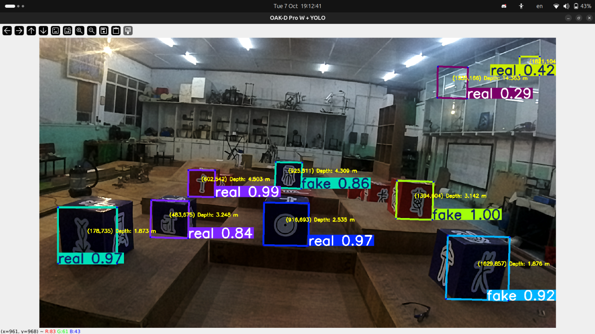
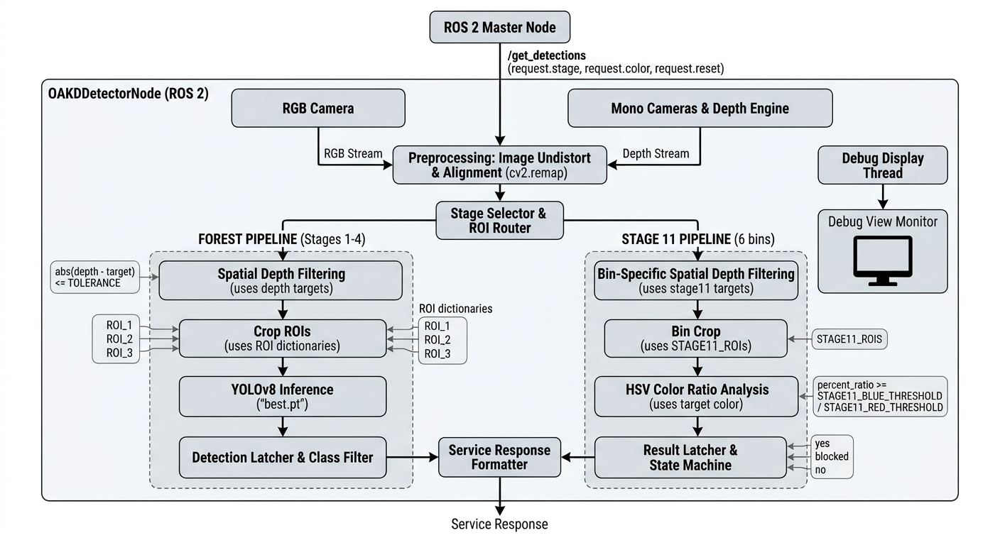
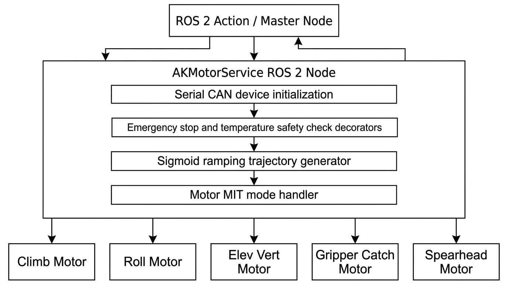
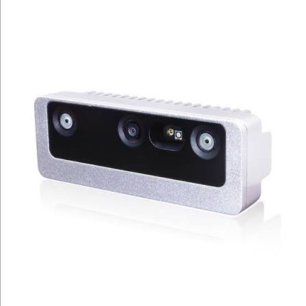
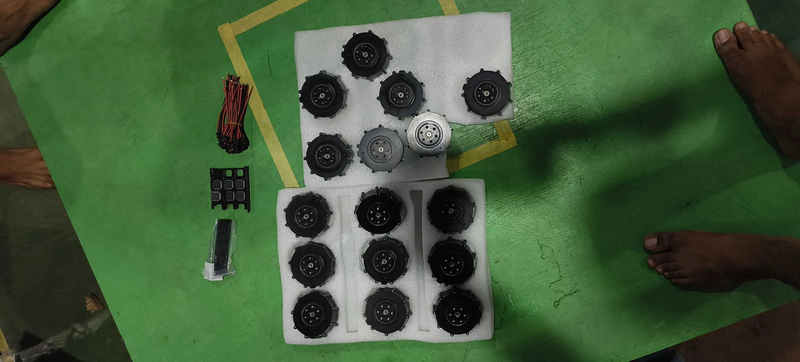
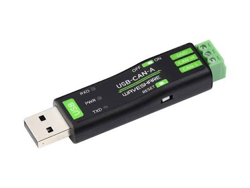

# OAK60 ROS2 - Advanced Robot Vision & Control System

[](https://docs.ros.org/en/humble/)
[](https://www.python.org/)
[](LICENSE)
[](https://www.python.org/dev/peps/pep-0008/)

A sophisticated ROS2-based system integrating OAK-D stereo vision with YOLO object detection and motor control, featuring advanced state machine logic for multi-ROI tracking and intelligent object classification.

---

## Table of Contents

- [Overview](#overview)
- [Features](#features)
- [System Architecture](#system-architecture)
- [Prerequisites](#prerequisites)
- [Installation](#installation)
- [Package Structure](#package-structure)
- [Configuration](#configuration)
- [Usage](#usage)
- [API Reference](#api-reference)
- [Contributing](#contributing)
- [License](#license)

---

## Overview

OAK60 ROS2 is an industrial-grade robot vision and control system that combines:

- **OAK-D Stereo Camera Integration**: Real-time RGB-D perception using DepthAI
- **YOLO v5/v8 Detection**: State-of-the-art object detection and classification
- **Multi-ROI Tracking**: Intelligent region-of-interest management with state machine logic
- **Motor Control**: AK-60 motor servo control via CAN bus with PID regulation
- **ROS2 Services**: Async communication for detection triggers and motor commands

Perfect for robotics applications including robotic arms, picking systems, and autonomous inspection platforms.

---

## Features

### Vision System
- **Multi-Region Detection**: Simultaneous tracking across 3 configurable ROIs
- **Dual Detection Models**: Support for multiple YOLO weight configurations
- **Depth Integration**: Combined RGB and depth information for robust detection
- **Real-time Processing**: Optimized frame pipeline with lock/timeout mechanisms
- **Color Material Recognition**: 6-channel color ROI analysis for material classification

### Control System
- **AK-60 Motor Integration**: Direct motor control with state feedback
- **CAN Bus Communication**: USB-CAN interface via WaveShare adapter
- **MIT Control Mode**: Advanced motor control protocols (position, velocity, torque)
- **Service-Based Control**: ROS2 service interface for motor commands (up/down/stop)
- **Thread-Safe Operations**: Lock-based synchronization for multi-threaded access

### ROS2 Framework
- **Service-Based Architecture**: GetDetections service for on-demand inference
- **Custom Message Interfaces**: Type-safe detection and control messages
- **Multi-Node Support**: Modular nodes for detection and control
- **Debug Variants**: Debug-enabled nodes with enhanced logging

<p align="center">
  
</p>

---

## System Architecture

<p align="center">
  
</p>
image: vision pipeline


<p align="center">
  
</p>
image: can motor pipeline

The system integrates three main components: OAK-D camera input, ROS2 node infrastructure with detection and motor control services, and YOLO models for inference. The architecture follows a modular design with state machine logic for ROI management.

### Package Breakdown

| Package | Purpose | Type |
|---------|---------|------|
| `ak_pkg` | Motor control and CAN communication | C++ Native/Python Wrapper |
| `oakd_roi_detector` | Vision system and detection logic | Python ROS2 |
| `oakd_roi_detector_interfaces` | Custom ROS2 message definitions | ROS2 Interfaces |

---

## Prerequisites

### Hardware
- OAK-D Stereo Camera (USB 3.1)
<p align="center">
  
</p>
image: OAK60 prow


<p align="center">
  
</p>
cybergear bldcs


<p align="center">
  
</p>
waveshare usb to can


- AK-60 Motor with CAN interface
- USB-CAN Adapter (WaveShare CH341 compatible)
- Compatible compute platform (Jetson, x86-64, ARM64)

### Software
- **ROS2 Humble** (or compatible distribution)
- **Python 3.8+**
- **CUDA 11.x+** (recommended for GPU inference)

### Dependencies
```bash
# Core ROS2 packages
ros-humble-rclpy
ros-humble-sensor-msgs
ros-humble-cv-bridge
ros-humble-std-msgs

# Vision & ML
opencv-python>=4.5.0
ultralytics>=8.0.0      # YOLO
depthai>=2.20.0         # OAK-D SDK
numpy>=1.21.0

# Serial/CAN Communication
pyserial>=3.5
```

---

## Installation

### 1. Clone Repository
```bash
cd ~/ros2_ws/src
git clone https://github.com/your-repo/OAK60_ROS2.git
cd OAK60_ROS2
```

### 2. Install Dependencies
```bash
# Install system dependencies
sudo apt-get update
sudo apt-get install -y \
    python3-pip \
    libopencv-dev \
    python3-opencv \
    libusb-1.0-0-dev

# Install Python dependencies
pip3 install opencv-python ultralytics depthai pyserial numpy rclpy
```

### 3. Build ROS2 Packages
```bash
cd ~/ros2_ws
colcon build --symlink-install --packages-select \
    oakd_roi_detector_interfaces \
    oakd_roi_detector \
    ak_pkg

# Source the workspace
source install/setup.bash
```

### 4. Configure Hardware Access
```bash
# Grant USB permissions for OAK-D
sudo usermod -a -G plugdev $USER
sudo usermod -a -G dialout $USER

# Load CAN kernel module
sudo modprobe can
sudo modprobe can_raw
```

---

## Package Structure

```
OAK60_ROS2/
├── src/
│   ├── ak_pkg/                           # Motor control package
│   │   ├── ak_pkg/
│   │   │   ├── __init__.py
│   │   │   ├── ak_60.py                  # Main motor service node
│   │   │   ├── ak_mit.py                 # MIT control protocol implementation
│   │   │   └── Waveshare.py              # CAN bus driver
│   │   ├── setup.py
│   │   └── package.xml
│   │
│   ├── oakd_roi_detector/                # Vision & detection package
│   │   ├── oakd_roi_detector/
│   │   │   ├── __init__.py
│   │   │   ├── detector_node.py          # Main detection service node
│   │   │   ├── detector_node_withdebug.py  # Debug variant
│   │   │   ├── webcam_detector_node.py   # Testing interface
│   │   │   ├── simple_detector_serial.py # Standalone detector
│   │   │   └── simple_serial_bridge.py   # Serial communication bridge
│   │   ├── models/
│   │   │   ├── best.pt                   # Primary YOLO weights
│   │   │   ├── best1.pt                  # Alternate YOLO weights
│   │   │   └── info.txt                  # Model configuration
│   │   ├── setup.py
│   │   └── package.xml
│   │
│   └── oakd_roi_detector_interfaces/     # Custom ROS2 messages
│       ├── srv/
│       │   └── GetDetections.srv         # Detection service definition
│       ├── package.xml
│       └── CMakeLists.txt
│
└── README.md
```

---

## Configuration

### ROI (Region of Interest) Configuration

Edit [detector_node.py](src/oakd_roi_detector/oakd_roi_detector/detector_node.py) to customize ROI coordinates:

```python
# Define three detection regions
ROI_1 = (((174, 519), (368, 663)), ...)    # Left region
ROI_2 = (((505, 574), (672, 707)), ...)    # Center region
ROI_3 = (((847, 499), (991, 641)), ...)    # Right region

# Timing configuration
ROI_TIMEOUT = 0.4          # Region timeout in seconds
ROI_TIMEOUT_SECOND = 0.20  # Secondary timeout
LOCK_FRAMES = 2            # Frames to lock after detection

# Color analysis
COLOR_ROI_COUNT = 6        # Number of color regions
COLOR_ROI_SIZE = 120       # Size of each region
COLOR_ROI_Y = 520          # Y-coordinate offset
```

### Motor Configuration

Edit [ak_60.py](src/ak_pkg/ak_pkg/ak_60.py) for motor parameters:

```python
self.device = "/dev/ttyCH341USB0"  # CAN device path
self.can_baud = 0x01               # CAN baud rate
self.motor_id = 1                  # Motor ID on CAN bus

# PID Control Parameters
self.kp = 12.0                     # Proportional gain
self.kd = 1.4                      # Derivative gain
self.dt = 0.002                    # Time step (2ms)
self.threshold = 1.0               # Position threshold
self.timeout = 5.0                 # Command timeout (seconds)
```

### Model Selection

Place YOLO weights in `src/oakd_roi_detector/models/`:
- Primary model: `best.pt`
- Alternate model: `best1.pt`

Update model path in detector node:
```python
self.model = YOLO(model_path)
```

---

## Usage

### 1. Launch Detection Service

```bash
ros2 run oakd_roi_detector detector_node
```

**Output:**
```
[oakd_detector]: OAK-D camera initialized
[oakd_detector]: YOLO model loaded: best.pt
[oakd_detector]: GetDetections service ready on /get_detections
```

### 2. Launch Motor Control Service

```bash
ros2 run ak_pkg ak_60_up
```

**Output:**
```
[ak_motor]: Motor service initialized
[ak_motor_up_execute]: Service ready
[ak_motor_down_exec]: Service ready
[ak_motor_stop]: Service ready
```

### 3. Call Detection Service

```bash
ros2 service call /get_detections oakd_roi_detector_interfaces/GetDetections \
  "{reset: false, trigger_roi: 'ROI1_ACTIVE', stage: 1}"
```

**Response:**
```yaml
success: true
status: "Detection completed"
roi1_class: "object_A"
roi2_class: "object_B"
roi3_class: "object_C"
roi1_martial: "metal"
roi2_martial: "plastic"
roi3_martial: "ceramic"
roi4_martial: "rubber"
roi5_martial: "fabric"
roi6_martial: "wood"
```

### 4. Control Motor

```bash
# Move motor up
ros2 service call /ak_motor_up_execute std_srvs/SetBool "{data: true}"

# Move motor down
ros2 service call /ak_motor_down_exec std_srvs/SetBool "{data: true}"

# Stop motor
ros2 service call /ak_motor_stop std_srvs/SetBool "{data: true}"
```

### 5. Debug Mode

For enhanced logging and visualization:

```bash
ros2 run oakd_roi_detector detector_node_withdebug
```

### 6. Test with Webcam

For development without OAK-D hardware:

```bash
ros2 run oakd_roi_detector webcam_detector_node
```

---

## API Reference

### GetDetections Service

**Service Definition**: [GetDetections.srv](src/oakd_roi_detector_interfaces/srv/GetDetections.srv)

#### Request
| Field | Type | Description |
|-------|------|-------------|
| `reset` | `bool` | Reset detector state |
| `trigger_roi` | `string` | Active ROI: "ROI1_ACTIVE", "ROI2_ACTIVE", "ROI3_ACTIVE" |
| `stage` | `int8` | Processing stage (1-3) |

#### Response
| Field | Type | Description |
|-------|------|-------------|
| `success` | `bool` | Detection successful |
| `status` | `string` | Status message |
| `roi1_class` | `string` | Detected class in ROI 1 |
| `roi2_class` | `string` | Detected class in ROI 2 |
| `roi3_class` | `string` | Detected class in ROI 3 |
| `roi1_martial` | `string` | Material classification channel 1 |
| `roi2_martial` | `string` | Material classification channel 2 |
| `roi3_martial` | `string` | Material classification channel 3 |
| `roi4_martial` | `string` | Material classification channel 4 |
| `roi5_martial` | `string` | Material classification channel 5 |
| `roi6_martial` | `string` | Material classification channel 6 |

### Motor Services

#### ak_motor_up_execute
```
Service: std_srvs/SetBool
Request: data (bool)
Response: success (bool), message (string)
```

#### ak_motor_down_exec
```
Service: std_srvs/SetBool
Request: data (bool)
Response: success (bool), message (string)
```

#### ak_motor_stop
```
Service: std_srvs/SetBool
Request: data (bool)
Response: success (bool), message (string)
```

---

## Development

### Code Style
This project follows **PEP 8** guidelines. Check and format code:

```bash
# Format code
autopep8 --in-place --aggressive --aggressive <file>.py

# Lint check
flake8 src/

# Type hints
mypy src/ --ignore-missing-imports
```

### Running Tests
```bash
colcon test --packages-select oakd_roi_detector ak_pkg
colcon test-result --verbose
```

### Debugging

Enable verbose logging:
```python
self.get_logger().set_level(rclpy.logging.LoggingSeverity.DEBUG)
```

Monitor ROS2 topics:
```bash
ros2 topic list
ros2 topic echo /detector_output
```

Monitor services:
```bash
ros2 service list
ros2 service info /get_detections
```

---

## Troubleshooting

### OAK-D Camera Not Detected
```bash
# Check USB connection
lsusb | grep Luxonis

# List available cameras
ros2 run depthai depthai_node
```

### Motor Control Issues
```bash
# Verify CAN device
ls -l /dev/tty*

# Test CAN communication
candump can0
```

### Detection Accuracy Issues
- Ensure adequate lighting conditions
- Adjust ROI coordinates for your setup
- Verify YOLO model weights are loaded
- Check inference threshold values in code

### ROS2 Build Failures
```bash
# Clean build
colcon build --packages-select oakd_roi_detector_interfaces
colcon build --packages-select oakd_roi_detector
colcon build --packages-select ak_pkg

# Check logs
colcon build --event-handlers console_direct+
```

---

## References

- [ROS2 Documentation](https://docs.ros.org/en/humble/)
- [OAK-D DepthAI SDK](https://docs.luxonis.com/projects/api/en/latest/)
- [Ultralytics YOLO](https://docs.ultralytics.com/)


## License

This project is licensed under the **Apache License 2.0** - see the [LICENSE](LICENSE) file for details.

---

## Authors & Maintainers

- **Project Lead**: Pratik Gyawali 

---

## Support

For questions, issues, or suggestions:
- **Email**: jetsonnvidia69@gmail.com
- **Issues**: Report issues on the project repository

---


